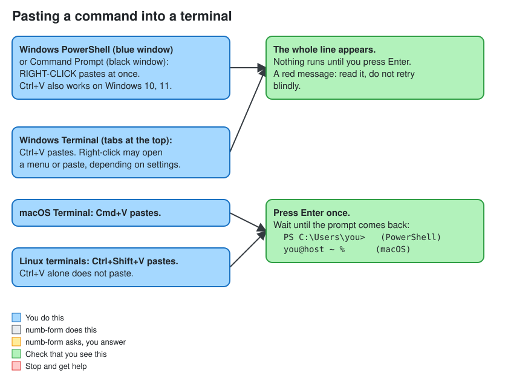

# Terminals and shells

This chapter explains the windows in which you type commands for
numb-form, and how they behave.
Read it if you have never pasted a command, or if a command does
something you did not expect.

## Synopsis

After reading this chapter, you will know:

* Which window is which: Windows PowerShell, PowerShell 7, Command
  Prompt, Windows Terminal, and the terminals of macOS and Linux.
* How to open each of them inside a folder.
* How to paste a command, and why pasting differs between them.
* How to tell that a command finished, and whether it worked.
* How commands are joined and quoted in each shell.

## Words used in this chapter

**terminal**
: The window that shows text and takes typed commands.

**shell**
: The program inside the terminal that reads your command and runs it.
  Windows PowerShell, PowerShell 7, Command Prompt (`cmd.exe`), `zsh`
  and `bash` are shells.

**prompt**
: The text at the start of the line where you type.
  The shell shows it again when a command has finished.

## Which window is which

| What you see | Shell | How to open it |
| --- | --- | --- |
| A blue window, prompt `PS C:\Users\you>` | Windows PowerShell 5.1, part of Windows 10 and 11 | **Start** menu, type `PowerShell`, choose **Windows PowerShell**. In a folder: type `powershell` in the address bar of File Explorer and press **Enter** |
| A black window, prompt `PS C:\Users\you>`, title *PowerShell 7* | PowerShell 7 (`pwsh`), installed separately | **Start** menu, type `pwsh` |
| A black window, prompt `C:\Users\you>` without `PS` | Command Prompt (`cmd.exe`) | **Start** menu, type `cmd`. In a folder: type `cmd` in the address bar |
| A window with tabs at the top | Windows Terminal, which runs any of the shells above | **Start** menu, type `Terminal`. In a folder (Windows 11): right-click the empty space in File Explorer and choose **Open in Terminal** |
| macOS, prompt ending in `%` | `zsh` in Terminal | **Finder**, **Applications**, **Utilities**, **Terminal**. In a folder: right-click the folder, **Services**, **New Terminal at Folder** |
| Linux or BSD, prompt ending in `$` | usually `bash` or `sh` | depends on the desktop, often **Ctrl+Alt+T** |

The guide uses Windows PowerShell 5.1, because every Windows 10 and 11
computer has it.
Every numb-form command works in all of these shells.
Only the joined commands of the installation differ (see
[Joining commands](#joining-commands)).

To check the version of PowerShell, type:

```
$PSVersionTable.PSVersion
```

It shows `5` in the column *Major* for Windows PowerShell and `7` for
PowerShell 7.

## Pasting a command



Copy a command from the documentation with the copy icon at the right
edge of the grey box, or select the whole line and press **Ctrl+C**.
Then paste it into the terminal:

| Terminal | Paste with | Notes |
| --- | --- | --- |
| Windows PowerShell and Command Prompt (the classic console window) | **right-click** | The text is pasted at once, without a menu. **Ctrl+V** also works on Windows 10 and 11 |
| Windows Terminal | **Ctrl+V** | A right-click pastes or opens a menu, depending on its settings |
| Terminal on macOS | **Cmd+V** | |
| Linux and BSD terminals | **Ctrl+Shift+V** | **Ctrl+V** alone does not paste. A middle click pastes the last selected text |

Pasting does not run the command.
Check that the whole line arrived, then press **Enter** once.

**Warning:** In a terminal, **Ctrl+C** does not copy.
It stops the running program.
Stopping numb-form with **Ctrl+C** is safe: accepted forms stay and the
form in progress is removed.
To copy text out of the classic console window, select it with the
mouse and press **Enter**.
In Windows Terminal, select it and press **Ctrl+Shift+C**.

**Note:** Windows Terminal can warn before it pastes several lines.
The documented commands are single lines, so this warning means that
more than the command was copied.
Copy it again with the copy icon.

## Knowing that a command finished

A command has finished when the prompt appears again on a new line.
Long commands, such as the installation, can take a minute.
Do not press **Enter** again while you wait.

A command worked when it prints what the documentation says it prints,
for example `OK, open a new PowerShell window`.
A command failed when it prints red text in PowerShell, or a line
starting with `error:` or the program name.
Read the message and look it up in
[When something goes wrong](guide.md#when-something-goes-wrong).
Running the same command again without a change gives the same error.

## Joining commands

Several commands on one line run one after the other.
The documentation stops at the first command that fails, so the
command after it does not run on a broken state.
How that is written depends on the shell:

| Shell | Run the next command only if the previous one worked |
| --- | --- |
| Windows PowerShell 5.1 | `first; if ($?) { second }`, or one `& { ... }` block with `$ErrorActionPreference = 'Stop'` |
| PowerShell 7, Command Prompt, `zsh`, `bash`, `sh` | `first && second` |

Windows PowerShell 5.1 does not know `&&`.
It answers `The token '&&' is not a valid statement separator`.
Use the line labelled **Windows** in the documentation, not the one
labelled **Unix-like**.

## Quoting paths and names

A path with spaces is one value only inside quotes:

```
numb-form -root "H:\14. GWG"
```

In PowerShell, double quotes `"..."` replace `$name` with the value of
a variable, and single quotes `'...'` keep the text as it is.
A name with a `$` in it, such as a company name, belongs in single
quotes.
In `cmd.exe`, only double quotes work.
In `zsh`, `bash` and `sh`, single quotes keep the text as it is, and
double quotes replace `$name`.

To run a program whose path has spaces, PowerShell needs `&` before the
quoted path:

```
& "$env:LOCALAPPDATA\Programs\numb-form\numb-form.exe" -version
```

Letters such as `ü`, `ß`, `é` or `ł` in paths and names work in every
shell listed here.

## Programs blocked by the company

Pasted commands are not scripts, so the PowerShell *execution policy*
does not block them.
A company can still block programs in the user's folders with AppLocker
or similar rules.
Then starting `numb-form` prints `This program is blocked by group
policy` or a similar message.
Ask the IT department to allow
`%LOCALAPPDATA%\Programs\numb-form\numb-form.exe`, or to install
numb-form in an allowed folder.
A blocked download is described in
[In a company network](install.md#in-a-company-network).

## SEE ALSO

[the step-by-step guide](guide.md), [installing](install.md),
[the reference manual](usage.md)
